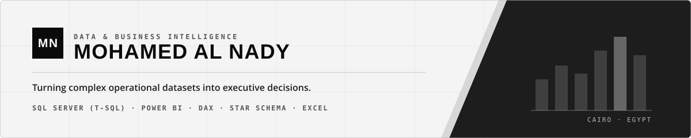

<picture>
  <source media="(prefers-color-scheme: dark)" srcset="./assets/header-dark.svg">
  <source media="(prefers-color-scheme: light)" srcset="./assets/header-light.svg">
  
</picture>

 

---

## About

Data & Business Intelligence Analyst specializing in **SQL Server (T-SQL)**, **Power BI (DAX)**, **Star & Constellation Schema modeling**, and **Excel Power Pivot**. I own end-to-end data preparation, automated reporting workflows, and desktop/mobile executive dashboards built directly for C-level decision-makers.

My portfolio focuses on **Medallion data warehousing, supply chain diagnostics, customer churn modeling, and workforce analytics** — combining technical data rigor with commercial intuition built through customer-facing real estate sales.

---

## Core Stack & Capabilities

<table>
<tr>
<td width="25%"><b>SQL &amp; Warehousing</b></td>
<td width="25%"><b>BI &amp; Executive Reporting</b></td>
<td width="25%"><b>Data Modeling &amp; Quality</b></td>
<td width="25%"><b>Analytics &amp; Tooling</b></td>
</tr>
<tr>
<td valign="top">

`Window Functions`  
`CTEs & Subqueries`  
`Complex Joins`  
`Reporting Views`  
`Medallion ETL`

</td>
<td valign="top">

`DAX Measures`  
`Power Pivot & Query`  
`Desktop & Mobile BI`  
`Executive Storytelling`  
`KPI Architecture`

</td>
<td valign="top">

`Constellation Schema`  
`Dimensional Modeling`  
`Data Cleaning & Audits`  
`Source Validation`  
`Schema Design (ERD)`

</td>
<td valign="top">

`Churn & Retention`  
`Customer Segmentation`  
`YoY & Margin Analysis`  
`Supply Chain KPIs`  
`Pandas & NumPy`

</td>
</tr>
</table>

---

## Featured Projects

### Power BI & Excel Executive Dashboards

| Project | Stack | Business Impact & Scope | Links |
| :--- | :--- | :--- | :---: |
| [**Samsung Global Performance & Supply Chain**](https://github.com/Nady-07/Samsung-Performance-Dashboard) | `Power BI` `30+ DAX` `Constellation Schema` | Diagnosed 4 enterprise domains across global operations: **\$176.95M** net revenue, **27.4%** net margin, **7,500** shipments, and **459** low-stock SKUs isolated. | [Repo](https://github.com/Nady-07/Samsung-Performance-Dashboard) · [Preview](https://nady-07.github.io/portfolio/#portfolio) |
| [**Telecom Customer Churn & Revenue Loss**](https://github.com/Nady-07/Telecom-Churn-Dashboard) | `Power BI` `DAX` `Star Schema` | Analyzed **7,043** accounts, isolated **\$2.86M** in churned revenue, and quantified how bundling 4+ add-ons cuts churn from **50.3% → 5.3%**. | [Repo](https://github.com/Nady-07/Telecom-Churn-Dashboard) · [Preview](https://nady-07.github.io/portfolio/#portfolio) |
| [**E-Commerce Sales & Delivery Performance**](https://github.com/Nady-07/Ecommerce-Sales-Delivery-Dashboard) | `Excel` `Power Pivot` `DAX` `Power Query` | Modeled **21,150** marketplace orders tracking **\$3.44M** net revenue, **6.39%** late delivery rate (1,351 orders), and regional demand concentration (São Paulo at **36%**). | [Repo](https://github.com/Nady-07/Ecommerce-Sales-Delivery-Dashboard) · [Preview](https://nady-07.github.io/portfolio/#portfolio) |
| [**IBM HR Attrition & Workforce Intelligence**](https://github.com/Nady-07/IBM-HR-Attrition-Dashboard) | `Power BI` `51 DAX` `Star Schema` | 4-page interactive workforce intelligence dashboard diagnosing turnover drivers across **1,470** employee records and **35** HR attributes. | [Repo](https://github.com/Nady-07/IBM-HR-Attrition-Dashboard) · [Preview](https://nady-07.github.io/portfolio/#portfolio) |
| [**Bank Customer Churn & Deposit Risk**](https://github.com/Nady-07/Bank-Customer-Churn-Dashboard) | `Power BI` `DAX` `Light & Dark UI` | Executive banking churn report analyzing **10,000** accounts to separate active-account deposit loss risk from inactive attrition. | [Repo](https://github.com/Nady-07/Bank-Customer-Churn-Dashboard) · [Preview](https://nady-07.github.io/portfolio/#portfolio) |
| [**AdventureWorks Sales & Profitability Workbook**](https://nady-07.github.io/portfolio/#portfolio) | `Excel` `Power Pivot` `PivotTables` | Tracked **\$14.54M** regional revenue (**28.7K** units) and modeled **\$126.29M** profit at a **41.1%** margin across distribution channels. | [Preview](https://nady-07.github.io/portfolio/#portfolio) |

### SQL Data Warehousing, Modeling & Analytics

| Project | Stack | Architecture & Analytical Scope | Links |
| :--- | :--- | :--- | :---: |
| [**SQL Data Warehouse — Medallion ETL**](https://github.com/Nady-07/SQL_Data_Warehouse_Project) | `SQL Server` `T-SQL` `Star Schema` | End-to-end **Bronze–Silver–Gold** data warehouse implementing automated T-SQL ETL pipelines, data quality checks, and dimensional modeling. | [Repo](https://github.com/Nady-07/SQL_Data_Warehouse_Project) · [Preview](https://nady-07.github.io/portfolio/#portfolio) |
| [**Flight Reservation Database & SQL Analysis**](https://github.com/Nady-07/Flight-Database-SQL-Analysis) | `SQL Server` `T-SQL` `Relational ERD` | Designed a normalized 5-table relational booking schema and solved 10 business queries analyzing **\$352.6K** revenue, airline market share (Delta at **26.5%**), and passenger loyalty. | [Repo](https://github.com/Nady-07/Flight-Database-SQL-Analysis) · [Preview](https://nady-07.github.io/portfolio/#portfolio) |
| [**Customer Segmentation & Advanced SQL EDA**](https://github.com/Nady-07/Advanced_EDA_Project) | `SQL Server` `T-SQL` `Window Functions` | Gold-layer analytics covering multi-year sales trends, running averages, cumulative revenue, YoY comparisons, and reusable RFM reporting views. | [Repo](https://github.com/Nady-07/Advanced_EDA_Project) · [Preview](https://nady-07.github.io/portfolio/#portfolio) |
| [**SQL Exploratory Data Analysis Framework**](https://github.com/Nady-07/EDA_Project) | `SQL Server` `T-SQL` `CTEs` | Structured EDA script suite auditing schemas, date boundaries, categorical distributions, magnitude KPIs, and top/bottom rankings. | [Repo](https://github.com/Nady-07/EDA_Project) · [Preview](https://nady-07.github.io/portfolio/#portfolio) |
| [**2024 Men's T20I Cricket — SQL Analysis**](https://github.com/Nady-07/t20i-sql-analysis) | `SQL Server` `T-SQL` `Window Functions` | 10 analytical SQL case-study queries across 122 international matches evaluating chasing vs. defending win rates, margin volatility, and venue trends. | [Repo](https://github.com/Nady-07/t20i-sql-analysis) · [Preview](https://nady-07.github.io/portfolio/#portfolio) |
| [**IPL Auction & Player Analytics — SQL**](https://github.com/Nady-07/ipl-sql-analytics) | `SQL Server` `T-SQL` `CTEs` | Exploratory SQL analysis of 228 players across 10 IPL franchises examining auction pricing, team spend efficiency, roles, and nationality mix. | [Repo](https://github.com/Nady-07/ipl-sql-analytics) · [Preview](https://nady-07.github.io/portfolio/#portfolio) |
| [**Interactive Analytics Portfolio Website**](https://github.com/Nady-07/portfolio) | `HTML5` `CSS3` `JavaScript` | Source repository for my monochrome editorial portfolio hub featuring dashboard walkthrough modals, DAX/SQL code previews, and interactive CV. | [Repo](https://github.com/Nady-07/portfolio) · [Live ↗](https://nady-07.github.io/portfolio/) |

---

## Experience

**Data Analyst** — *Arab Company for Calcium Carbonate* (`Feb 2026 – Oct 2026`)
- Owned end-to-end data preparation and executive reporting as the company's **sole Data Analyst**, delivering insights directly to the CEO and factory owner.
- Audited, cleaned, and standardized raw operational Excel datasets to eliminate missing and inconsistent source records prior to reporting.
- Built recurring management reports in Excel and interactive **Power BI dashboards** with dedicated **desktop and mobile layouts**.

**Commercial & Sales Background**
- **Smart Step** — *Real Estate Agent (Resale)* (`2023 – 2025`): Maintained 200+ structured property listings and recurring Excel pricing, availability, and conversion reports.
- **MLS** — *Real Estate Agent (Primary Sales)* (`2022 – 2023`): Managed customer follow-up pipelines, developer pricing benchmarks, and sales tracking in Excel.

---

## Education & Training

- **Bachelor of Commerce (B.Com)** — Helwan University, Cairo (`2018 – 2022`)
- **Modern Data Warehouse – Data Engineering** — Udemy (`Jun 2026`)
- **Data Analysis Diploma** — EraaSoft Academy (`Apr 2026`)
- **Complete SQL Bootcamp** — Udemy (`2026`)

---

**Cairo, Egypt** &nbsp;·&nbsp; [Live Portfolio ↗](https://nady-07.github.io/portfolio/) &nbsp;·&nbsp; [LinkedIn](https://www.linkedin.com/in/mohamed-alnady-52b87123b) &nbsp;·&nbsp; [mohamednady0@outlook.com](mailto:mohamednady0@outlook.com)

